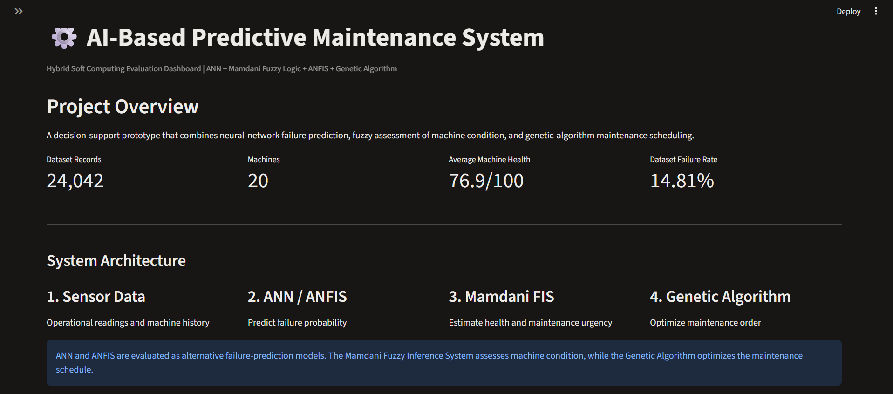
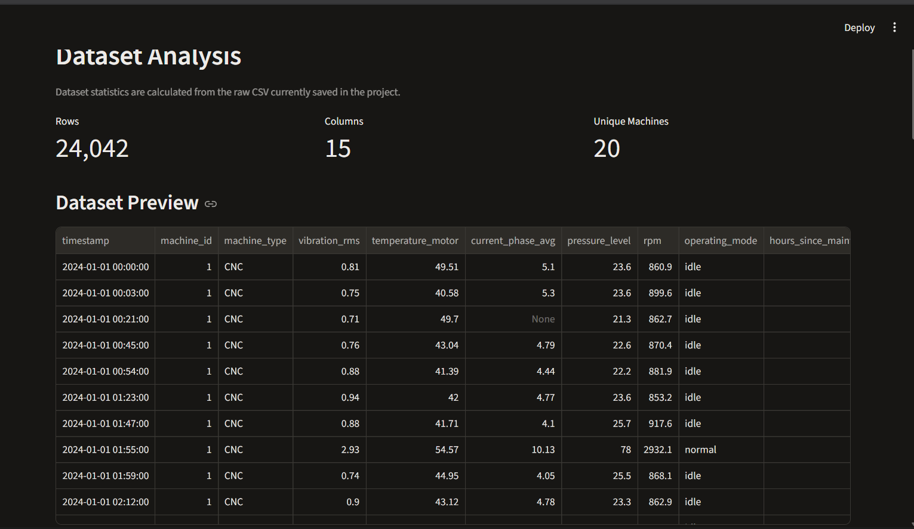
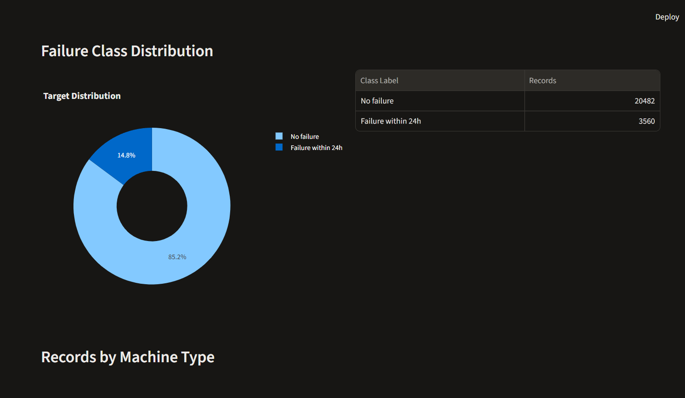
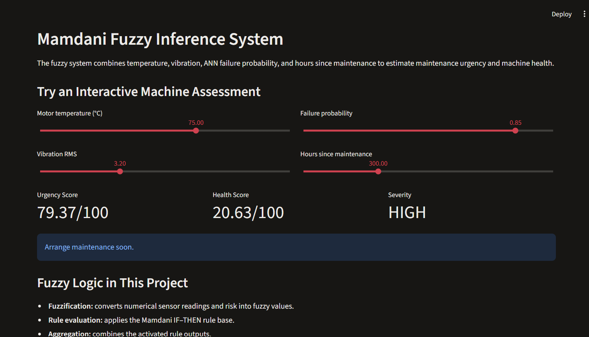
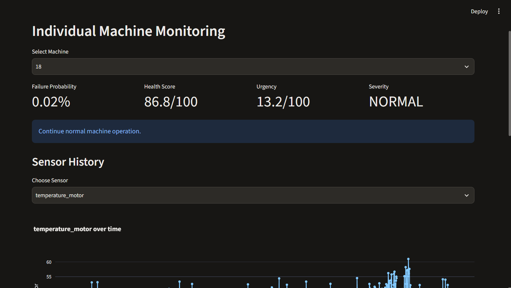
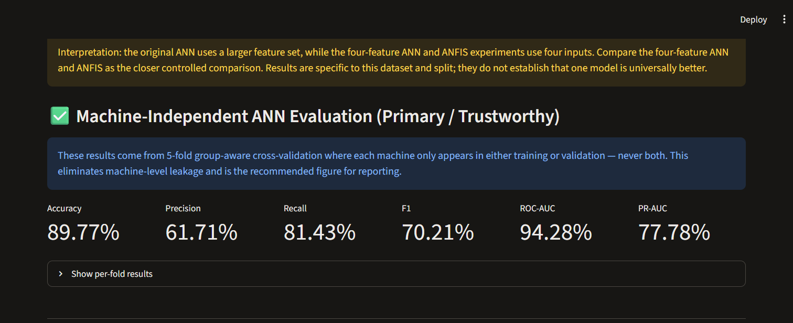
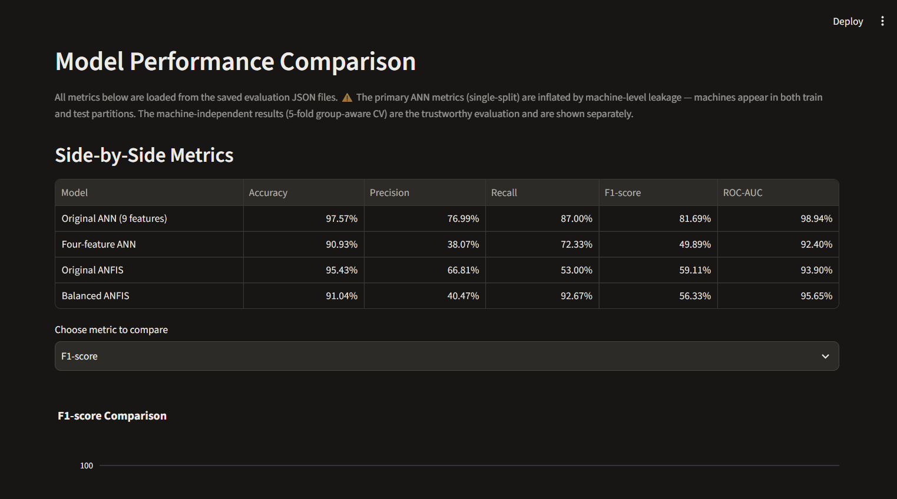
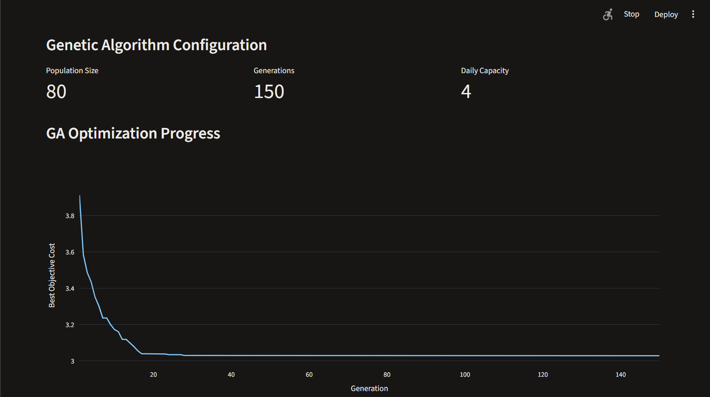
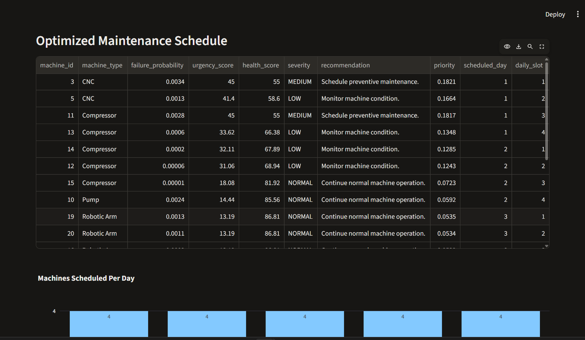

# AI-Based Predictive Maintenance System
## Project Report

**Project area:** Soft computing for machine failure prediction and maintenance planning  
**Repository reviewed:** `Satwik1428/Predictive-Maintenance`  
**Evaluation basis:** checked-in source, saved experiment artifacts, and the verification suite run on 10 November 2026  
**Status:** academic prototype; results are dataset-specific and not field validated

## Assessment Rubric (20 Marks)

| Criterion | Marks | Evidence in this report |
|---|---:|---|
| Abstract, Introduction & Problem Definition | 2 | Sections 1 and Abstract |
| Literature Survey & Research Gap | 3 | Section 2 and References |
| Proposed Methodology / System Design | 3 | Section 3 |
| Implementation | 2 | Section 4 and dashboard figures |
| Results & Analysis | 4 | Section 5, saved metrics, confusion counts, and UI figures |
| Discussion, Limitations & Future Scope | 2 | Section 6 |
| Article / Patent / Startup Proposal Documentation | 2 | Section 7 |
| References & Citation Quality | 1 | Section 8, with numbered in-text citations and DOI links |
| Organization, Formatting & Presentation | 1 | Structured sections, results tables, figures, and artifact map |
| **Total** | **20** | |

## Abstract

This project implements a predictive-maintenance prototype that links machine sensor records to a binary estimate of failure within 24 hours and a maintenance priority. It compares feed-forward artificial neural networks (ANN) with adaptive neuro-fuzzy inference systems (ANFIS). A Mamdani fuzzy inference system translates predicted risk and selected condition indicators into a human-readable urgency and health score. A genetic algorithm (GA) then orders machine jobs subject to an assumed daily capacity and a machine-type changeover penalty. A Streamlit dashboard presents data, saved metrics, machine assessments, fuzzy rules, and the saved schedule.

The checked-in dataset has 24,042 records for 20 machines and a 14.81% overall positive-label rate, according to project artifacts. The most defensible saved ANN evaluation is five-fold, machine-grouped cross-validation: accuracy 89.77%, precision 61.71%, recall 81.43%, F1 70.21%, ROC-AUC 0.9428, and PR-AUC 0.7778. This evaluation reduces machine-identity leakage but does not test prospective future-time or external-plant generalization. On a separate chronological test split, balanced ANFIS reaches 92.67% recall (278/300 failures detected) at 40.47% precision and 409 false alarms. The GA reduces its assumed objective by 3.88% relative to priority ordering. Dataset provenance, membership boundaries, and scheduling costs still need external validation. No industrial performance or savings claim is supported by the current evidence.

## 1. Introduction and problem definition

Reactive maintenance can leave an organization with little warning before equipment failure, while calendar-based preventive maintenance can consume staff and parts before they are needed. Predictive maintenance attempts to use condition and operating data to inform when equipment should be inspected or serviced. However, a probability score alone does not explain urgency or allocate scarce maintenance capacity.

The project addresses three linked tasks:

1. Estimate whether failure is likely within the next 24 hours from sensor, operating, and maintenance-history features.
2. Convert risk and condition indicators into an interpretable urgency category and health score.
3. Produce a capacity-constrained order for the machine jobs using a transparent scheduling objective.

The scope is a software and evaluation prototype. It is not a real-time sensor integration, validated safety system, or autonomous work-order issuer. Human review and plant-specific validation would be required before operational use.

## 2. Literature survey and research gap

Predictive-maintenance research uses condition monitoring and supervised learning to detect faults and forecast maintenance needs. Susto et al. describe a multiple-classifier approach in a semiconductor manufacturing context and motivate data-driven maintenance decisions [1]. Recent reviews continue to identify reproducible data and cross-domain generalization as important issues for industrial predictive maintenance [2].

Neural networks can model nonlinear relationships between a vector of sensor/operating variables and a failure label. This repository uses a scikit-learn multilayer perceptron (MLP) rather than introducing a new ANN training method. Its two ANFIS experiments follow the adaptive neuro-fuzzy idea of combining fuzzy-rule structure with data-fitted parameters [3]. The separate Mamdani FIS uses linguistic sets and rules to make an urgency assessment inspectable; Mamdani and Assilian's controller is an early reference for this rule-based inference style [4].

Maintenance scheduling is a constrained combinatorial problem: urgency, limited capacity, changeovers, and other plant constraints can conflict. Prior work has applied genetic algorithms to joint production and maintenance scheduling [5]. This project is a smaller single-objective demonstration, with a capacity assumption and a type-changeover penalty.

**Research gap addressed by this prototype:** the project demonstrates an end-to-end software workflow that joins failure prediction, an interpretable fuzzy condition assessment, and a resource-aware machine-job order, and it exposes comparisons and saved outputs in a dashboard. The evidence supports integration and reproducibility within the repository; it does not establish a new predictive algorithm or an industrially validated maintenance policy.

**Literature work still needed for a submission:** document databases and search terms, inclusion/exclusion rules, and the selection date; add several directly relevant peer-reviewed studies; compare their data, validation protocol, metrics, and limitations against this implementation. The references below provide a verified starting set, not a complete systematic survey.

## 3. Proposed methodology and system design

### 3.1 Data and preparation

The project uses `dataset/raw/predictive_maintenance_v3.csv`, with processed train/test files and a saved preprocessing summary. The project artifacts report 24,042 records, 20 machine IDs, and 15 columns. The binary target is `failure_within_24h`. Its distribution is 20,482 class-0 and 3,560 class-1 records (85.19% / 14.81%). The preprocessing script validates required columns and the binary target, removes exact duplicates and invalid timestamps, sorts chronologically, and makes an 80:20 split. The saved split contains 19,233 training and 4,809 test records. Positive prevalence is 16.95% in training (3,260 records) and 6.24% in test (300 records).

The model inputs are seven numerical features (`vibration_rms`, `temperature_motor`, `current_phase_avg`, `pressure_level`, `rpm`, `hours_since_maintenance`, `ambient_temp`) and two categorical features (`machine_type`, `operating_mode`). `failure_type`, `estimated_repair_cost`, and `rul_hours` are excluded from the ANN predictors. Model pipelines impute numeric missing values using training medians, standardize numeric inputs, impute categorical values with the most frequent category, and one-hot encode categories. Random oversampling is fitted on training data only in the ANN and balanced ANFIS paths.

**Provenance caveat:** the checked-in repository does not identify the raw CSV's creator, source URL, collection protocol, or license. Its provenance must be verified before the data is described as a public benchmark or redistributed. This report therefore calls it the repository dataset.

### 3.2 ANN prediction

The primary ANN is a scikit-learn MLP classifier with ReLU hidden activations and hidden layer sizes (32, 16, 8), trained with Adam. The pipeline includes imputation, scaling, one-hot encoding, and training-only random oversampling. The primary script evaluates a chronological 80:20 split. Because each machine has records on both sides of that split, these scores are not used as the main claim for new-machine generalization.

The group-aware experiment uses five-fold `StratifiedGroupKFold`, grouping on `machine_id`, with a check that train and validation machine sets are disjoint in every fold. Each fold fits a fresh copy of the preprocessing/sampling/model pipeline. It pools out-of-fold probabilities and reports accuracy, precision, recall, F1, ROC-AUC, and PR-AUC. This tests performance on machines excluded from each fold's training data. It does not preserve forward-in-time evaluation: folds are stratified by machine group over the full dataset, so future-period generalization remains untested. The use of group-aware splitting follows the purpose of keeping each group within one side of a split [6].

The repository also compares four ANN configurations using the same five group-aware folds and early stopping. The four-feature ANN is a separate chronological-split comparison using the same four inputs as ANFIS. Threshold scripts sweep saved out-of-fold probabilities. These sweeps are exploratory because selecting a threshold and scoring it on the same OOF predictions is not a separate validation step.

### 3.3 ANFIS prediction

The two ANFIS experiments use four features: motor temperature, vibration RMS, average phase current, and hours since maintenance. Each feature receives two Gaussian membership functions, producing 16 rule combinations. The model initializes premise centers from training quantiles, fits normalized firing strengths and linear Sugeno consequent terms, and optimizes premise parameters with L-BFGS-B on a seeded training subset. Consequents are refit on the training data. Median imputation and standardization are fitted on training data and applied to the held-out test data. The balanced variant applies random oversampling to the training data only; the unbalanced version does not.

### 3.4 Mamdani fuzzy assessment

The Mamdani system receives motor temperature, vibration RMS, ANN failure probability, and hours since maintenance. It fuzzifies each input into low/medium/high linguistic memberships using shoulder, triangular, and trapezoidal functions. Its explicit rule base includes high-risk and joint high-condition rules, an overdue-maintenance rule, a low-risk/healthy rule, and a physical-danger override for high temperature with low ANN risk. Rule antecedents use minimum, rule outputs are clipped and aggregated by maximum, and centroid defuzzification over 0–100 yields urgency. Health is `100 - urgency`; score bands map to NORMAL, LOW, MEDIUM, HIGH, and CRITICAL recommendations.

These rules provide a traceable decision layer but are encoded assumptions. The membership boundaries and rule consequences have not been validated with maintenance engineers or a plant safety policy.

### 3.5 Genetic algorithm scheduling

For each machine, the scheduler uses the latest timestamped record, fills remaining inputs using dataset medians/modes, obtains ANN failure probability, and calculates fuzzy urgency. Combined priority is 0.60 times failure probability plus 0.40 times normalized urgency. A chromosome is a permutation of machine jobs. The objective sums risk-weighted waiting position plus a changeover penalty between different machine types within a day. Capacity is four machines per day. CRITICAL jobs are pinned to the earliest positions. The implementation uses population 80, 150 generations, 15% swap-mutation probability, four elites, tournament selection, order crossover, and random seed 42. It compares the resulting schedule with FIFO and descending-priority order.

The saved objective is dimensionless and uses assumed values. It omits real calendars, workforce skill, parts availability, job duration, production dependencies, and hard deadlines. The optimizer returns a best-found result under this implementation, not a proof of global optimality.

### 3.6 Dashboard and software workflow

The Streamlit dashboard reads the local dataset, trained artifacts, and saved result files. It provides dataset analysis, ANN/ANFIS metric comparison, a machine monitoring view, interactive fuzzy assessment, a saved GA schedule, and experimental results and limitations. It is a local demonstration interface, not a live telemetry service. `requirements.txt` lists pandas, NumPy, scikit-learn, imbalanced-learn, SciPy, joblib, Streamlit, and Plotly.

*Figure 1. Dashboard overview from the supplied project UI screenshots. The dashboard's 76.9/100 average health is a displayed snapshot, not a model-validation metric.*

*Figure 2. Dataset Analysis page: 24,042 rows, 15 columns, 20 machine IDs, and a sample of the sensor records.*

*Figure 3. Dashboard target distribution: 20,482 records without failure and 3,560 with failure within 24 hours.*

*Figure 4. Fuzzy assessment example: at the displayed settings, urgency is 79.37/100, health is 20.63/100, and severity is HIGH.*

## 4. Implementation

The implementation is organized into separate Python scripts under `src/`, a dashboard under `dashboard/`, data under `dataset/`, serialized models under `models/`, and machine-readable results under `results/`. The existing `run_all_tests.py` defines checks for Python compilation, fuzzy edge cases, GA critical-job ordering, ANFIS artifact loading, saved machine-independent metrics, ANN configuration results, threshold-output files, and a headless dashboard health endpoint.

This report analyzes the existing saved artifacts. No training, preprocessing, or threshold experiment was rerun while preparing it. The existing verification suite was run once as requested and is summarized below. Training scripts write to the existing model/result filenames; preserve them by using a separate experiment copy and distinct output directory for future experiments.

**Verification run, 10 November 2026:** the existing `run_all_tests.py` suite passed all eight checks after rerunning with UTF-8 console output. It compiled 16 Python modules, passed four fuzzy edge cases and GA critical-job ordering checks (1, 4, and 6 critical machines), loaded both ANFIS artifacts, checked the five-fold ANN metrics and four ANN configurations, validated six threshold result files, and received HTTP 200 from the headless dashboard health endpoint. The first attempt stopped at a Windows CP1252 console encoding error while printing a checkmark; it did not reach a project assertion. No model training or experiment was run by this verification suite. See [verification summary](verification_summary.md).

*Figure 5. Individual Machine Monitoring page with the selected machine's saved assessment and temperature history.*

## 5. Results and analysis

### 5.1 Machine-independent ANN

The pooled five-fold group-aware results saved in `machine_independent_ann_metrics.json` are:

| Metric | Result |
|---|---:|
| Accuracy | 89.77% |
| Precision | 61.71% |
| Recall | 81.43% |
| F1-score | 70.21% |
| ROC-AUC | 0.9428 |
| PR-AUC | 0.7778 |
| True negatives | 18,683 |
| False positives | 1,799 |
| False negatives | 661 |
| True positives | 2,899 |

Recall indicates that the pooled OOF predictions identify 2,899 of 3,560 positive records, while precision indicates that false alarms remain substantial. PR-AUC is included because the class distribution is imbalanced. Per-fold results vary: F1 ranges from approximately 53.90% to 82.71%, which cautions against treating the pooled mean as stable across machine subsets.

*Figure 6. The dashboard presents the five-fold machine-grouped ANN metrics separately from the chronological single-split comparison.*

### 5.2 ANN configuration comparison

All rows below use the saved 5-fold machine-grouped OOF evaluation and a 0.5 classification threshold.

| Configuration | Accuracy | Precision | Recall | F1 | ROC-AUC | PR-AUC |
|---|---:|---:|---:|---:|---:|---:|
| Baseline (32, 16, 8) | 89.77% | 61.71% | 81.43% | 70.21% | 0.9428 | 0.7778 |
| Deep (64, 32, 16) | 89.17% | 60.48% | 77.50% | 67.94% | 0.9260 | 0.6359 |
| Regularized (64, 32) | 89.38% | 60.82% | 79.52% | 68.92% | 0.9384 | 0.7583 |
| Large (128, 64, 32) | 89.63% | 62.29% | 75.87% | 68.41% | 0.9225 | 0.6861 |

The baseline has the highest recall, F1, ROC-AUC, and PR-AUC among the saved configurations; the large network has slightly higher precision and lower false positives but also lower recall. The comparison should not be read as an exhaustive hyperparameter search.

### 5.3 Four-feature ANN and ANFIS comparison

These results use the repository's separate chronological test split with 300 positive test records. They are not directly equivalent to the group-aware ANN results above.

*Figure 7. Dashboard comparison view. The single-split nine-feature ANN is shown for completeness; the group-aware result above is the more appropriate result for unseen-machine claims.*

| Model | Accuracy | Precision | Recall | F1 | ROC-AUC | FP | FN |
|---|---:|---:|---:|---:|---:|---:|---:|
| Four-feature ANN | 90.93% | 38.07% | 72.33% | 49.89% | 0.9240 | 353 | 83 |
| Original ANFIS | 95.43% | 66.81% | 53.00% | 59.11% | 0.9390 | 79 | 141 |
| Balanced ANFIS | 91.04% | 40.47% | 92.67% | 56.33% | 0.9565 | 409 | 22 |

Balanced ANFIS has the highest recall and ROC-AUC in this four-feature comparison, detecting 278 of the 300 failures and missing 22. Its 409 false positives are the highest of the three. The unbalanced ANFIS produces fewer false alarms but misses 141 failures. This makes the cost of a false alarm versus a missed failure central to choosing a useful operating point. The result does not establish that balanced ANFIS is superior for deployment.

### 5.4 Threshold analysis

The saved threshold CSVs evaluate multiple thresholds using OOF probabilities and include alternative assumed false-negative cost scenarios. Raising the threshold generally reduces false positives but also reduces recall. These files are useful for illustrating the trade-off and are explicitly exploratory; final threshold selection requires nested or otherwise independent validation and plant-calibrated costs.

### 5.5 Maintenance schedule

The saved schedule covers 20 machines at a capacity of four per day. Its GA objective is 3.0284 compared with 3.1505 for descending-priority ordering and 4.7758 for FIFO. This is a 3.88% reduction against priority ordering and 36.59% against FIFO for the saved run. Since the objective uses assumed weights and does not represent money or a complete factory schedule, the reduction is evidence only about the modeled objective on this instance.

*Figure 8. Saved GA objective history over 150 generations; the plotted value is the prototype objective, not a monetary cost.*

*Figure 9. Saved maintenance order, daily slots, urgency, and recommended action for the 20 machines.*

## 6. Discussion, limitations, and future scope

The repository has several methodological strengths: preprocessing is separated from model scripts; missing-value transformations and oversampling are fitted within training pipelines; a group-aware ANN evaluation addresses machine overlap; PR-AUC and confusion counts make class-imbalance effects visible; and the dashboard discloses known limitations. Fuzzy recommendations and the schedule provide decision-support context beyond a raw classifier score.

The primary limitations are:

- **Dataset provenance:** the repository does not document its source, license, collection method, or sensor calibration. This prevents independent assessment of realism and lawful reuse.
- **Temporal and external validity:** group-aware cross-validation tests held-out machine IDs but mixes time periods across folds. There is no future-time holdout, external site, or prospective validation.
- **Class distribution shift:** the chronological test set has 6.24% positives versus 16.95% in training. This can change precision, calibration, and operational alarm rates.
- **High alert burden:** the group-aware ANN yields 1,799 false positives on 20,482 negative records; balanced ANFIS yields 409 false alarms in the separate test comparison.
- **Threshold tuning:** OOF threshold selection and evaluation use the same OOF predictions; independent threshold validation is not shown.
- **Model comparability:** the primary nine-feature ANN, the four-feature ANN, and ANFIS experiments use different feature sets and protocols. Only the four-feature ANN/ANFIS comparison is closer to controlled, and it is still limited to one chronological split.
- **Fuzzy expert validation:** rule text and membership limits are implemented but are not derived from documented expert elicitation or validated maintenance thresholds.
- **Scheduling realism:** the cost objective, capacity, critical-job rule, and changeover penalty are assumptions; stochastic stability across seeds and richer baselines are not reported.
- **Deployment readiness:** there is no live sensor ingestion, access control, production monitoring, model drift process, uncertainty reporting, CMMS integration, or human-approved work-order workflow.

Recommended future work is to verify and cite dataset provenance; add a locked future-time and external-machine evaluation; report confidence intervals and per-machine outcomes; use nested validation for model and threshold choice; calibrate probabilities and decision costs; validate fuzzy rules with maintenance staff; incorporate real job duration, shifts, skills, parts, deadlines, and production constraints in scheduling; repeat GA runs across seeds; and conduct a prospective pilot with human oversight.

## 7. Article, patent, or startup proposal documentation

The repository currently provides an academic system prototype rather than a complete article, patent specification, or validated business case. A suitable article framing is **“A Hybrid ANN–Fuzzy–Evolutionary Decision-Support Prototype for Predictive Maintenance”**, with the contribution limited to integration and a transparent comparison on a verified dataset. Before submission, complete the systematic literature search, establish data provenance, provide independent validation, and avoid novelty or generalization claims not supported by experiments.

For a startup proposal, the dashboard and scheduling flow can be described as a concept for helping small manufacturers prioritize inspections. No savings, uptime improvement, or commercial readiness should be claimed without customer discovery and a measured pilot. No patentability opinion is made in this report.

## 8. References

[1] G. A. Susto, A. Schirru, S. Pampuri, S. McLoone, and A. Beghi, “Machine Learning for Predictive Maintenance: A Multiple Classifiers Approach,” *IEEE Transactions on Industrial Informatics*, vol. 11, no. 3, pp. 812–820, 2015. https://doi.org/10.1109/TII.2014.2349359

[2] D. Guidotti, L. Pandolfo, and L. Pulina, “A Systematic Literature Review of Supervised Machine Learning Techniques for Predictive Maintenance in Industry 4.0,” *IEEE Access*, vol. 13, pp. 102479–102504, 2025. https://doi.org/10.1109/ACCESS.2025.3578686

[3] J.-S. R. Jang, “ANFIS: Adaptive-Network-Based Fuzzy Inference System,” *IEEE Transactions on Systems, Man, and Cybernetics*, vol. 23, no. 3, pp. 665–685, 1993. https://doi.org/10.1109/21.256541

[4] E. H. Mamdani and S. Assilian, “An Experiment in Linguistic Synthesis with a Fuzzy Logic Controller,” *International Journal of Man-Machine Studies*, vol. 7, no. 1, pp. 1–13, 1975. https://doi.org/10.1016/S0020-7373(75)80002-2

[5] B. Mota, P. Faria, and C. Ramos, “Joint Production and Maintenance Scheduling for Total Cost and Machine Overload Reduction in Manufacturing: A Genetic Algorithm Approach,” *IEEE Access*, vol. 11, pp. 98070–98081, 2023. https://doi.org/10.1109/ACCESS.2023.3312557

[6] scikit-learn developers, “StratifiedGroupKFold,” *scikit-learn User Guide*. https://scikit-learn.org/stable/modules/cross_validation.html#stratifiedgroupkfold

## Appendix A. Reproducibility and artifact map

| Evidence | Repository file |
|---|---|
| Dataset counts, missingness, chronological split | `results/preprocessing_summary.json` |
| Machine-independent five-fold results | `results/machine_independent_ann_metrics.json`, `machine_independent_ann_folds.csv`, `machine_independent_ann_predictions.csv` |
| ANN configuration comparison | `results/ann_optimization_metrics.csv` |
| Single-split ANN metrics | `results/ann_metrics.json` |
| Four-feature ANN results | `results/ann_fair_metrics.json` |
| ANFIS results | `results/anfis_metrics.json`, `results/anfis_balanced_metrics.json` |
| Example fuzzy assessment | `results/fuzzy_example.json` |
| GA objective, configuration, and convergence trace | `results/ga_metrics.json` |
| Saved machine order | `results/ga_maintenance_schedule.csv` |
| Existing verification definitions | `run_all_tests.py` |
